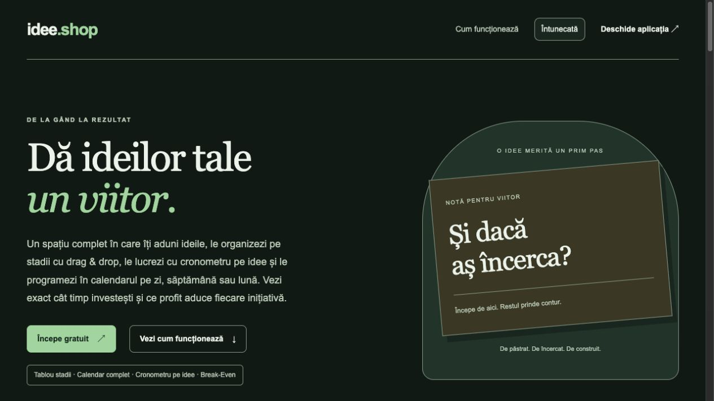
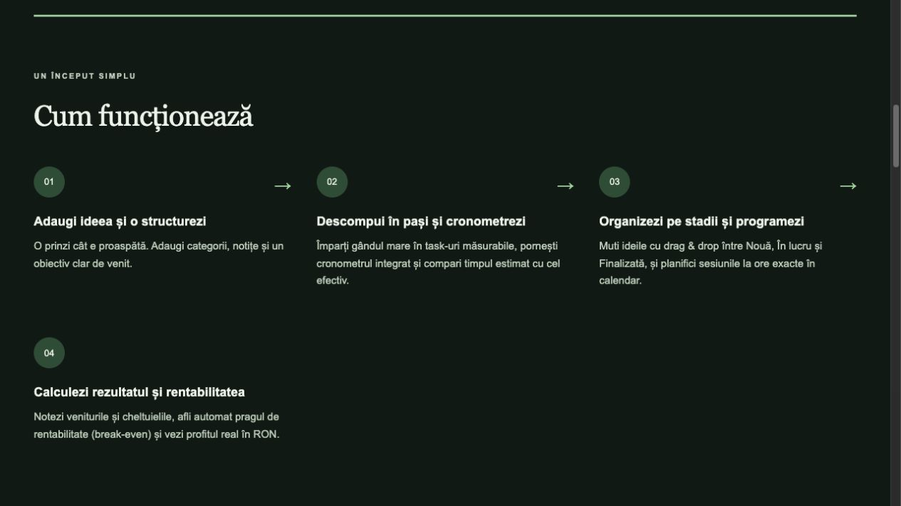
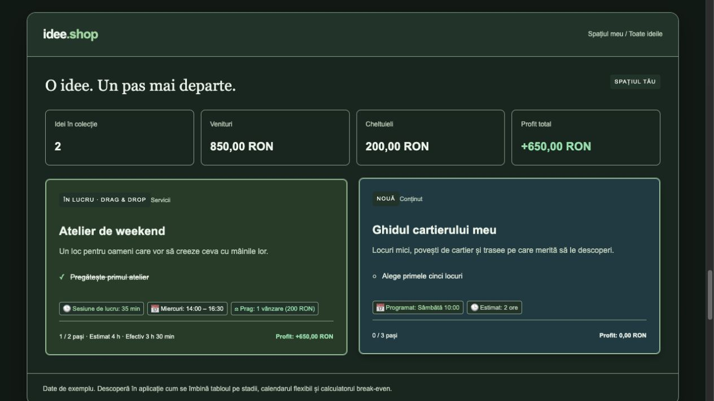

# Idee.Shop

Idee.Shop te ajută să transformi o idee într-un proiect pe care îl poți urmări. Notezi ce vrei să faci, împarți proiectul în task-uri, programezi lucrul și vezi cât timp și câți bani ai investit.

- **Idei și proiecte** cu stadii, categorii, obiective și un frigider virtual pentru ideile fixate.
- **Task-uri și subpași** cu priorități, etichete, estimări, filtre, reordonare și progres.
- **Calendar** pe zi, săptămână sau lună, cu sesiuni de lucru, recurențe și sincronizare manuală opțională către Google Calendar.
- **Timp și rezultate** cu cronometru pe idee, total lucrat, tarif orar editabil, venituri, cheltuieli, profit și prag de rentabilitate în RON.
- **Pagini și note** cu blocuri, subpagini, proprietăți și formulare cu răspunsuri afișate în tabel sau carduri.
- **Integrare MCP opțională** pentru agenți precum Hermes, cu acces pe cont la idei, task-uri și programări.

Proiectul folosește Next.js, TypeScript, Tailwind CSS și SQLite. Conturile și colecțiile se păstrează în baza de date a instanței.

## Capturi din pagina de prezentare

**Pagina de start**



**Cum funcționează**



**Previzualizare cu date demonstrative**



## Pornire pe Mac
Node 24 LTS sau mai nou (vezi .nvmrc):
```sh
cd idee.shop
npm ci
npm run dev
```
http://127.0.0.1:3000. Pentru build: `npm run check`, apoi `npm start`. Serverul rămâne legat de 127.0.0.1; nu este configurat hosting sau acces din internet. Oprește cu Ctrl+C.

## Primul administrator
```sh
npm run admin:setup
```
Comanda salvează o cheie privată în `data/admin-setup-key.txt` (sau lângă baza configurată prin IDEE_DATABASE_PATH), fără să o afișeze în loguri. Cheia este valabilă 24 ore, o singură utilizare. Deschide http://127.0.0.1:3000/admin/setup, alege numele/emailul/parola și introdu cheia din fișier. Nu trimite parola sau cheia în conversații. Dacă a expirat, repetă comanda. Nu există parolă implicită.
Primul cont creat prin înregistrarea obișnuită NU devine administrator. Configurarea cu cheia proprietarului este separată. Colecția existentă din prima versiune este atribuită administratorului la configurare; copia inițială din SQLite este păstrată pentru recuperare. Dacă emailul dorit este deja înregistrat, folosește un email distinct pentru administrare; apoi poți administra contul existent din panou.

## Rute
- `/`: prezentarea produsului și exemple demonstrative, fără date personale.
- `/login`: autentificare sau creare cont obișnuit. Recuperarea parolei este gestionată de administrator; nu există recuperare automată prin email.
- `/app`: colecția proprie, protejată pe server și în UI.
- `/admin`: panou exclusiv pentru administratori: utilizatori, roluri, blocare/reactivare, sesiuni, resetare parole, toate colecțiile, statistici, export și backup.
- `/app?userId=ID`: editor pentru colecția selectată din administrare, autorizat exclusiv pentru admin. Nu importă datele browserului în contul selectat.

## Conturi și sesiuni
Numele, emailul și hash-urile parolelor sunt în SQLite. Parolele sunt derivate cu PBKDF2-SHA256, 210000 iterații, salt 16 bytes, hash 32 bytes; nu sunt salvate în clar sau afișate în administrare. Sesiunile folosesc token aleator în cookie HttpOnly/SameSite=Strict și doar hash-ul tokenului în SQLite. Cu bifă: maximum 7 zile, cookie persistent. Fără bifă: cookie de sesiune, maximum 12 ore; refresh-ul NU mai închide sesiunea. Închiderea browserului urmează comportamentul cookie-urilor de sesiune și setările browserului.
Ieșirea revocă sesiunea pe server. Blocarea, schimbarea rolului sau resetarea parolei revocă toate sesiunile acelui cont. Ultimul administrator activ nu poate fi blocat sau retrogradat. Încercările repetate de autentificare sunt limitate. Emailul nu este verificat prin mesaje.
Profilul vechi din browser poate fi importat la login numai după verificarea parolei existente. Nu primește automat rol de admin. Datele de acces vechi sunt șterse din browser doar după confirmarea contului și sesiunii pe server. Înregistrările noi nu preiau automat colecția veche din browser; o pot importa explicit prin JSON, dacă se dorește.

## Bază de date și backup
Colecțiile sunt în `data/idee-shop.sqlite`; configurabil prin `IDEE_DATABASE_PATH` în .env.local. Fiecare cont are o colecție separată; administratorul le poate vedea și edita pe toate. Datele nu sunt criptate pe disc. Fișierul bazei, cheile și copiile de siguranță sunt excluse din Git.
```sh
npm run db:backup
```
Backup consistent în data/backups, incluzând conturi și hash-urile parolelor; păstrează o copie sigură pe un alt disc. Exportul administrativ JSON conține metadatele utilizatorilor și colecțiile, fără hash-uri, salt-uri sau tokenuri. Nu este un format de restaurare a conturilor: restaurarea completă se face din backup SQLite.
La restaurare oprește aplicația și configurează IDEE_DATABASE_PATH către o copie a backup-ului, păstrând originalele. Nu suprascrie o bază deschisă și nu șterge WAL/SHM în timp ce aplicația rulează. Pentru hosting trebuie volum persistent, HTTPS, origine autorizată și o revizuire de producție; aplicația este în continuare restricționată la loopback.

## Utilizare și păstrarea datelor
Adaugă idei, pași, note, venituri/cheltuieli și obiective RON. Datele sunt salvate prin API cu revizii, prevenind suprascrierile între file. La eroare, draftul rămâne în memoria paginii: păstrează pagina deschisă și exportă-l înainte de refresh. Nu există coadă offline persistentă. Copia veche idee.shop.v1 este păstrată pentru recuperare; transferul automat este permis doar administratorului/profilurilor vechi verificate și este idempotent. Ștergerea datelor browserului nu șterge conturile sau colecțiile din bază.

## Verificare și transfer
`npm run check`: lint, TypeScript, teste Node și build. Testele folosesc baze temporare, fără conturi reale. Vezi AGENTS.md, docs/HANDOFF.md, TASKS.md, DATABASE.md, ARCHITECTURE.md și DECISIONS.md. ECC complet: docs/ECC.md; după clonare, `npm run ecc:restore`, `npm run ecc:install`, `npm run ecc:doctor`.
Interfața folosește limbaj de produs, fără etichete ale mediului de dezvoltare. Nu promite sincronizare, marketplace sau verificare email care nu există.

## Timp estimat si efectiv
Completeaza manual ore si minute in sectiunea Timpul ideii sau sub fiecare task, apoi apasa Salveaza timpul. Estimarea ideii este bugetul total; fara ea, folosim suma estimarilor task-urilor. Efectivul aduna task-urile si timpul suplimentar al ideii: nu introduce din nou totalul in acest camp. Campuri goale = nespecificat, 0 = zero minute. Totalurile includ doar duratele completate; bifa nu inventeaza o durata. Fara cronometru automat. Duratele sunt pastrate in SQLite, backup JSON si administrare.

## Acces privat prin Tailscale
Tailscale Serve existent trimite HTTPS catre 127.0.0.1:3000. IDEE_APP_ORIGIN din .env.local autorizeaza exact originea HTTPS, fara wildcard; exemplu in .env.example. Pornire: npm start, apoi tailscale serve --bg 3000 daca nu este configurat deja. Deschide adresa HTTPS afisata, fara :3000, cu Tailscale conectat pe dispozitiv. Mac-ul gazda ramane pornit si fara repaus. Nu folosim Funnel/publicare. API verifica Host si Origin, iar cookie-ul este Secure pe originea HTTPS. Nu sunt acceptate arbitrar X-Forwarded-Host/Proto.


## Clone și verificare

Din directorul proiectului, folosește Node 24, apoi rulează `npm ci` și `npm run check`. Pentru a porni versiunea verificată, rulează `npm start`. Repository-ul conține codul, documentația și catalogul ECC. Configurează o bază și un cont propriu conform secțiunilor de mai sus.

Pentru Google Calendar și Hermes, vezi [Google Calendar](docs/GOOGLE-CALENDAR.md) și [MCP](docs/MCP.md). Pentru prima încărcare a codului, vezi [GitHub](docs/GITHUB.md).
